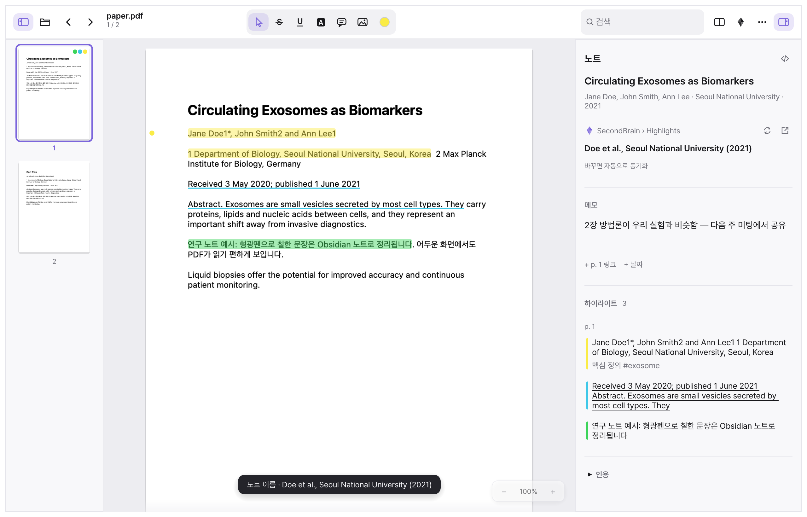

# PDF Notes

PDF를 읽으며 형광펜·밑줄·메모를 남기면, 그 내용이 **Obsidian 노트로 자동 정리**되는 맥·윈도우용 앱입니다.



## 할 수 있는 것

- **주석**: 형광펜, 밑줄, 취소선, 메모, 그림 영역 캡처 · 8가지 색 · 되돌리기
- **Obsidian 연동**: 바꾸면 자동 동기화, `저자, 기관 (연도)` 식의 노트 이름, 쪽 링크, 태그(`#태그`), 메모 양방향
- **PDF에 저장**: 주석을 PDF 파일에 써서 다른 PDF 앱에서도 보이고, 다른 앱에서 단 주석도 가져옵니다
- **인용**: DOI로 서지 정보를 찾아 APA·BibTeX 등으로 복사
- **AI에게 묻기**(선택): Claude Code · Codex · Ollama · API 키 중 가진 것으로 요약과 질문
- 여러 문서 탭, 나란히 보기, 다크 모드(PDF 포함), 단축키 바꾸기

## 설치

[Releases](../../releases) 에서 받으세요.

**맥** — `PDF-Notes-…-mac.dmg` 를 열고 앱을 응용 프로그램 폴더로 끌어다 놓습니다.
Apple에 등록(공증)하지 않은 앱이라 처음 열 때 경고가 나옵니다.
*시스템 설정 → 개인정보 보호 및 보안* 맨 아래의 **그래도 열기** 를 한 번 눌러 주세요.

**윈도우** — `PDF-Notes-…-windows-x64.zip` 을 풀고 `PDF Notes.exe` 를 실행합니다.
`pdfium.dll` 은 같은 폴더에 그대로 두세요. "Windows의 PC 보호" 화면이 나오면 **추가 정보 → 실행**.

## 직접 빌드하기

[Rust](https://rustup.rs) 가 필요합니다.

```sh
cargo run --release          # 실행
cargo test                   # 테스트
./bundle.sh                  # 맥: dist/PDF Notes.app 만들기
```

윈도우에서는 PDF 엔진 [PDFium](https://github.com/bblanchon/pdfium-binaries/releases) 의
`pdfium.dll` 을 실행 파일 옆(또는 `PDFIUM_DIR` 환경 변수가 가리키는 폴더)에 두어야 합니다.
맥은 시스템의 PDFKit을 쓰므로 따로 필요한 것이 없습니다.

## 구조

| 파일 | 하는 일 |
|---|---|
| `src/app.rs` | 화면 전체 (egui) |
| `src/pdf/mac.rs` · `src/pdf/pdfium.rs` | PDF 엔진: 맥은 PDFKit, 윈도우는 PDFium |
| `src/obsidian.rs` · `src/markdown.rs` | 노트 만들기와 Obsidian 동기화 |
| `src/citation.rs` · `src/naming.rs` | 인용, 노트 이름 짓기 |
| `src/ai.rs` | AI 연결 |

## 알아 둘 점

- 윈도우 버전은 새로 만든 것이라 맥 버전보다 덜 다듬어져 있습니다. 문제를 발견하면 [Issues](../../issues) 에 알려 주세요.
- 화면 언어는 지금 한국어뿐입니다.
- API 키는 파일이 아니라 시스템의 암호 보관함(맥 키체인, 윈도우 자격 증명 관리자)에 저장됩니다.

## 라이선스

코드는 [LICENSE](LICENSE) 를 따릅니다. 포함된 글꼴 Pretendard는 [SIL Open Font License](fonts/OFL.txt),
윈도우 배포본에 함께 들어가는 PDFium은 BSD-3-Clause / Apache-2.0 라이선스입니다.

---

**English** — PDF Notes is a PDF reader for macOS and Windows that turns your highlights, underlines and
comments into Obsidian notes, kept in sync automatically. Written in Rust with egui. The interface is
currently Korean only. Download from [Releases](../../releases), or build with `cargo run --release`.
